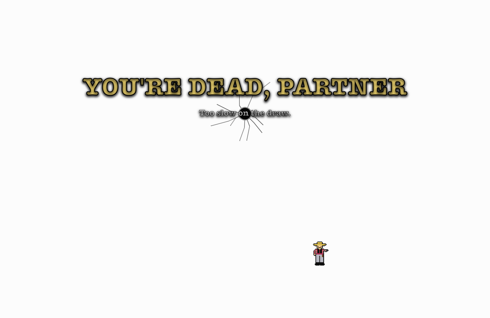
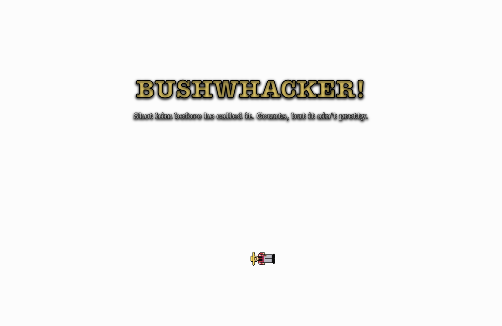

# Quick Draw

A macOS menu-bar homage to **WinFight** (Artematica, Windows 3.1). You launch it and nothing happens. Then, some time later, a little pixel cowboy pops up somewhere on your screen, hollers **"Draw!"**, and shoots you unless you click him first.

| Too slow | Shot too early |
|---|---|
|  |  |

- One bullet per duel. Miss and you're left with a bullet hole and an empty chamber.
- **Fight Now** (⌘F) starts a duel straight away. **Timed Fight** ambushes you at random.
- Three difficulties: Greenhorn (1.3s), Gunslinger (0.8s), Legend (0.5s).
- He won't ambush you while your screen is locked or you're away from the keyboard.
- Your win/loss record and fastest draw are saved.

## Install

Download the `.dmg` from [Releases](../../releases), open it, and drag **Quick Draw** into Applications.

The app is ad-hoc signed, not notarized. The first time you open it, right-click the app and choose **Open**, or allow it under System Settings → Privacy & Security.

## Build from source

Requires the Xcode Command Line Tools (macOS 13+).

```bash
./build.sh             # build/Quick Draw.app
./build.sh --install   # also copy it to ~/Applications
./build.sh --dmg       # also package build/QuickDraw-<version>.dmg
```

The version lives in `VERSION`. The build number is the git commit count.

## Releasing

1. Bump `VERSION` and commit.
2. `./build.sh --dmg`
3. `git tag v$(cat VERSION) && git push --tags`
4. `gh release create v$(cat VERSION) build/QuickDraw-$(cat VERSION).dmg`
